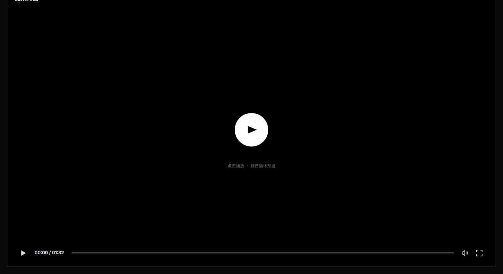
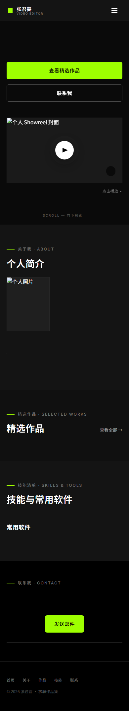

# 张君睿作品集 · 网站优化审计

> **2026-10-24 修复更新**：本报告中的图片体积、案例页封面裂图、占位联系方式、SEO/无 JS、SPA 导航、安全头、缓存压缩、可访问性问题已完成代码/资源修复；复测数据与改动明细见 [修复记录.md](修复记录.md)。仍待处理：视频文件、真实肖像/封面（当前带 AI 生成水印）、字体自托管、国内托管、5 部案例详情。

- 审计对象：线上 <https://zzjjr.github.io/zjrportfolio/>、全栈版 `portfolio/`、静态版 `portfolio-spa/`、构建与部署文档
- 审计时间：2026-10-24
- 方法：Chrome Headless + CDP 实测（390×844 移动端、1440×900 桌面端）、源码走查、HTTP 头检查、登录/限流/交互测试
- 说明：PageSpeed Insights API 返回 429，未取得 Lighthouse 分数；下表中的数字均为本机实测原始数据，不是估算分数。

---

## 一、结论：先修这 5 件事

整体视觉完成度不错，深色影院风、信息层级和响应式都成立。但当前版本**不适合直接投递**，原因不是设计，而是内容和基础工程质量：

1. **网站里没有任何视频。** Showreel 和 6 部作品的 `video` 字段全为空；点播放会弹出“登录后台配置视频”的提示。对剪辑师作品集来说，这是最致命的问题。
2. **首屏和案例页太重。** 8 张 PNG 共 15.35 MB；移动端 LCP 实测 2.98 s（未限速）。直接打开案例页时，SPA 还会先渲染首页，导致首页 8 张图全部加载。
3. **不执行 JS 时页面是空壳。** 无 JS 时正文可读文本只有 191 个字符，`h1` 为空，没有 OG/Twitter/canonical/JSON-LD；百度、微信、LinkedIn 等抓取到的就是空页面。
4. **全栈版案例页封面裂图。** `case.html` 的 `#playerPoster` 从未被赋值；服务器版案例页播放器是一片黑底加裂图图标。
5. **联系方式与社交链接是占位。** 电话 `+86 138-0000-0000`、三个社交链接都是 `#`，页脚还写着“本页内容可在后台管理系统中随时更新”。

---

## 二、实测数据

| 指标 | 实测值 | 说明 |
|---|---|---|
| 首页图片总量 | **15.35 MB**（8 张 PNG） | 最大 `work-city.png` 2.24 MB，尺寸 1536×1024 |
| 案例页图片请求 | 12 个请求 / **23.48 MB**（禁用缓存） | 直接打开案例页；正常缓存下唯一图片仍是首页 8 张 = 15.35 MB |
| 案例页实际需要的图片 | 4 张 / 约 8.1 MB | 播放器封面 + 3 张“更多作品”封面 |
| 移动端 LCP | **2.98 s**（未限速） | `showreel.png` 加载耗时 2.1 s，与 LCP 高度吻合 |
| 移动端 CLS | 0.0018 | 表现良好 |
| Google Fonts CSS | **459 KB（解码）/ 124 KB（传输）** | 仅字体 CSS，不含字体文件；耗时约 1.09 s |
| 首页 HTML | 81.9 KB | 内联了 CSS、JS、内容 JSON，未压缩、未 minify |
| 无 JS 正文 | 191 字符，`h1` 为空 | 各区块标题在，但人物、作品、联系方式全部为空 |
| 对比度 | `#737373` / `#141414` = **3.89:1**；`#525252` / `#141414` = **2.36:1** | 均低于 WCAG AA 普通文本 4.5:1 |
| robots.txt / sitemap.xml | 线上均 **404** | 无站点地图、无抓取规则 |
| OG / Twitter / canonical / JSON-LD | **0 / 0 / 无 / 0** | 分享卡片与结构化数据全部缺失 |

图片压缩估算（Pillow 实测，WebP q80，作品图 960w、Showreel 1280w、肖像 800w）：

| 原图 | 原大小（十进制 MB） | 优化后 |
|---|---|---|
| `showreel.png` | 1.66 MB | 55 KB |
| `portrait.png` | 1.79 MB | 34 KB |
| `work-city.png` | 2.24 MB | 77 KB |
| `work-tech.png` | 2.23 MB | 72 KB |
| 其余 4 张作品图 | 1.70–1.96 MB | 29–54 KB |
| **合计** | **15.35 MB（14.64 MiB）** | **约 0.38 MB（-97%）** |

> 这些图在页面上的实际显示尺寸只有约 400×225（作品卡）和 620×349（Showreel），1536px 原图大部分像素被浪费。

---

## 三、P0：投递/上线前必须修

### P0-1 视频全部为空，且把后台提示暴露给访客

**证据**

- `portfolio/data.json:18`：Showreel `video: ""`
- `portfolio/data.json:85、171、182、193、204、215`：6 部作品 `video` 全部为空
- `SYNC.md:83` 也明确写着“视频：目前全为空”
- 线上/全栈版点击播放后的提示是：“尚未配置视频文件地址 — 登录后台「作品管理」即可为这部作品粘贴视频链接”（`portfolio/public/js/main.js:46`、`portfolio-spa/js/app.js:165`）

**影响**

- 招聘方点开作品集，第一件事就是点播放；现在得到的是“登录后台”的开发提示。
- Showreel 封面、时长 `01:30`、播放按钮、脉冲动画都在暗示“有视频”，实际没有，信任成本很高。
- 6 部作品卡片全部有播放按钮，等于 7 个失效入口。

**建议**

1. 至少补齐 **Showreel + 2–3 部代表作**。Showreel 控制在 30–90 秒，1080p H.264，码率 4–8 Mbps，单文件 8–20 MB；作品视频同理，不要直接传 200 MB 原片。
2. 视频放对象存储/CDN（阿里云 OSS、腾讯云 COS、Cloudflare R2 等），用外链；不要和静态站点捆在一起。
3. 在视频补齐前，把播放按钮改成“案例拆解 →”或直接隐藏，不要留下 7 个点了没反应的入口。
4. 把“登录后台”这类内部提示从公开页面移除；游客不需要知道后台存在。

**验收**：页面上每个可见的播放按钮都能播放；任何情况下都不出现“登录后台”字样。

---

### P0-2 全栈版案例页播放器封面裂图

**证据**

- `portfolio/public/case.html:61` 只有 ``，没有 `src`。
- `portfolio/public/js/main.js:277` 的 `setupCasePlayer(player, src, posterSrc, ...)` 收到了 `posterSrc`，但函数体内从未给 `#playerPoster` 赋 `src`；`posterSrc` 只在没有视频时用于弹窗（`main.js:320`）。
- 实测 DOM：`#playerPoster.src = null`，`naturalWidth = 0`。
- 线上静态 SPA 不受影响，因为它在 `app.js:420` 用 `imgTag(work.cover, ...)` 直接生成了封面；所以这是**全栈版独有**的 bug。

现场截图：`case-player-bug.png`



**修复**

在 `setupCasePlayer` 里加一行即可：

```js
var posterEl = player.querySelector('.player-poster');
if (posterEl && posterSrc) posterEl.src = posterSrc;
```

同时把 `alt` 改成具体作品名，例如 `alt="《城市晨光》视频封面"`。

**验收**：`/case?id=city-morning` 打开后播放器显示封面，而不是黑底 + 裂图 + “视频封面”文字。

---

### P0-3 占位联系方式、死链与内部文案

**证据**

- 电话：`portfolio/data.json:294` → `+86 138-0000-0000`（假号码）
- 社交：`data.json:296-309` → 小红书 / 哔哩哔哩 / 抖音的 `url` 全部是 `#`
- 页脚：`data.json:313` → “本页内容可在后台管理系统中随时更新”
- “查看全部 →”：`portfolio/public/index.html:113` 指向 `#works`，而页面已经展示了全部 6 部作品，点了等于没点
- 案例页提示：`case.html:65` → “点击播放 · 静音循环预览”，但内联播放器既没有静音也没有循环
- 章节编号：只有 `SECTION 01`、`SECTION 03`，没有 02/04
- 6 部作品中 5 部 `detail: null`，案例页只能用“该作品的详细案例说明正在整理中……”的通用文案（`main.js:229`、`app.js:390`）

**影响**

- 招聘方看到假电话/空社交，会直接降低可信度。
- 页脚的后台提示暴露内部实现，对访客没有价值。
- “查看全部”和通用案例文案会让页面显得没做完。

**建议**

1. 电话要么填真实号码并改成 `tel:` 链接，要么按 `SYNC.md:91` 原本的说法写成“微信/电话：邮件联系后提供”，不要放 `138-0000-0000`。
2. 社交链接要么填真实主页，要么隐藏整块；不要让 `target="_blank"` 打开一个 `#` 新标签页。
3. 删除公开页脚的“后台管理系统”提示。
4. “查看全部”改成作品筛选（口播/短片/广告），或直接删掉。
5. 案例页提示改成“点击播放”；如果要静音循环预览，就在 `setupCasePlayer` 里真的设置 `video.muted = true; video.loop = true;`。
6. 章节编号补齐 02/04，或全部删除。
7. 5 部没有案例详情的作品：要么补 3–5 句“背景/职责/难点/结果”，要么先从“精选作品”里下架，不要用“正在整理中”占位。
8. 顺手改掉 `data.json:44` 的“3 大擅长剪辑方向”这类语病。

---

### P0-4 图片体积与加载策略：15.35 MB → 约 0.4 MB

**证据**

- `portfolio/public/images/` 8 张 PNG：1536×1024 或 1024×1536，合计 15,350,212 字节（15.35 MB）。
- HTML/JS 中没有任何 `loading`、`decoding`、`fetchpriority`、`srcset`、`sizes`（全项目 grep 无匹配）。
- 首页 8 张图全部立即加载；案例页因为 `renderHome()` 无条件先执行（`app.js:880-883`），即使直接打开 `#case=...`，首页 8 张图也全部进入 DOM 并加载。
- 实测案例页（禁用缓存）12 个图片请求、23.48 MB；正常缓存下唯一资源仍是 8 张 = 15.35 MB。
- 移动端 LCP 2.98 s；`showreel.png` 单张 1.66 MB，加载 2.1 s。

**修复**

1. 生成 480/960/1280 三档 WebP（或 AVIF），用 `<picture>` + `srcset` + `sizes`；作品卡 480/960 足够，Showreel 960/1280，肖像 400/800。
2. 首屏 Showreel 加 `fetchpriority="high"`，并在 `<head>` 预加载；其余图片 `loading="lazy" decoding="async"`。
3. 案例页不要先渲染首页：按当前 hash 只渲染目标视图，或至少给首页图片加 `loading="lazy"` 并把隐藏视图的图片 `src` 延后设置。
4. 给 `` 补 `width`/`height`（或继续用容器的 `aspect-ratio`），避免 CLS。
5. 后台上传也要优化：目前图片上传上限 10 MB，原样落盘（`server.js:52-55`、`admin.js:304-307`），以后换一张 8 MB 封面就会把性能打回原形。建议上传时在浏览器端用 Canvas 压到 1600px/WebP q80，或服务端用 Pillow/sharp 统一处理。
6. 视频封面不要用视频原帧的 4K 截图；按显示尺寸导出。

**预期**：8 张图合计 < 0.8 MB（2x 屏也够），首页 LCP 可降到 1.5 s 以内；案例页只加载 4 张，约 0.1–0.2 MB。

---

### P0-5 无 JS 空壳、Hash 路由与分享/SEO 缺失

**证据**

- 线上无 JS 实测：`h1` 为空、正文可读文本 191 字符、8 张图全部裂图；截图 `live-nojs.png`。


- 所有内容由 `window.__CONTENT__` + JS 注入；`portfolio-spa/index.template.html:56` 的 `<h1>` 是空的。
- 案例页用 `#case=id`（`app.js:228-234`），不是独立 URL；搜索引擎和社交抓取通常不会把 hash 当页面。
- `robots.txt`、`sitemap.xml` 线上 404。
- 无 `og:*`、`twitter:*`、`canonical`、`JSON-LD`、`theme-color`。

**影响**

- Google 能执行 JS，但百度、微信、LinkedIn、Slack、Telegram 等预览基本只读 HTML；分享出去就是“张君睿 · 视频剪辑师 — 求职作品集”加空白预览。
- 目标受众在中国，百度/微信的权重很高；不能假设它们会渲染 JS。
- 案例页无法作为独立页面被收录，也无法给每部作品做单独的分享卡片。
- 另有一个 SPA 细节：从案例页返回首页后，浏览器标签标题仍停留在上一个案例标题（实测 `口播 — 张君睿 · 视频剪辑师`），因为 `renderHome()` 只在启动时设置一次 `document.title`，`showView('home')` 没有恢复。

**建议（按投入从低到高）**

1. 低成本：补 `<meta property="og:title/description/image/url">`、`twitter:card`、`canonical`、`theme-color`、`robots.txt`、`sitemap.xml`；OG 图用 1200×630、< 300 KB。
2. 中成本：构建时把 `data.json` 直接渲染成 HTML（首屏 hero、简介、作品卡、联系方式），而不是只注入 JSON；这样无 JS 也能读，LCP 图片也能被预加载。
3. 中成本：为每部作品生成独立静态页（如 `/case/city-morning.html` 或 `/work/city-morning/`），而不是只有 `#case=`；全栈版则在服务端按 `?id=` 输出对应 `<title>`、description、OG。
4. 结构化数据：`Person`（name、jobTitle、email、address、sameAs）+ `ProfilePage` + `VideoObject`（name、description、thumbnailUrl、uploadDate、duration、contentUrl）。
5. 补 `404.html`、`apple-touch-icon`、`site.webmanifest`；给 `/admin` 加 `X-Robots-Tag: noindex`。
6. 修 SPA 标题：`showView('home')` 时把 `document.title` 恢复为站点标题，或在 `renderHome()` 里统一设置。

**验收**：禁用 JS 后仍能看到姓名、职位、简介、至少 3 部作品标题与联系方式；`view-source` 里能看到 OG 和正文；分享链接有标题/描述/图。

---

## 四、P1：强烈建议修

### P1-1 SPA 导航的三个实际 bug（线上版）

实测（Chrome 390×844，线上）：

| 操作 | 结果 |
|---|---|
| 案例页 A → 滚到底 → 点“更多作品”进入案例 B | 新页面 `scrollY = 1521`，直接停在案例 B 的底部，而不是顶部 |
| 案例 B → 点“首页” | 标签标题仍是 `口播 — 张君睿 · 视频剪辑师`，没有恢复站点标题 |
| 案例页播放视频 → 点“首页” | `showView` 只把 `view-case` 设为 `display:none`，没有暂停/移除 `<video>`；配置视频后音频会继续播放 |

**原因**

- `app.js:195`：`if (currentView === name) return;` 导致案例 A → 案例 B 时跳过 `window.scrollTo(0, 0)`。
- `app.js:194-218`：`showView` 不更新 `document.title`，也不暂停隐藏视图里的媒体。
- `app.js:251`：`document.querySelector(target)`，当 `target` 是 `#/` 时不是合法 CSS 选择器，会抛 `DOMException`（首页链接的延迟滚动逻辑因此失效）。

**修复**

- 视图内容变化时（即使 `name` 相同）也执行 `scrollTo(0,0)`；或在 `route()` 的 `#case=` 分支里先滚动。
- `showView` 里统一恢复/设置标题；首页标题从 `CONTENT.profile.name` 生成。
- 离开案例视图时暂停并移除 `<video>`，同时关闭视频弹窗。
- 把 `#/` 映射到 `#view-home`，或改用 `document.getElementById`。

---

### P1-2 字体：Google Fonts 459 KB CSS + 国内可达性

**证据**

- `portfolio-spa/index.template.html:9-13`、`portfolio/public/index.html:9-14` 从 `fonts.googleapis.com` 加载 Inter + Noto Sans SC 4 个字重。
- 实测字体 CSS 解码后 459 KB、传输 124 KB、耗时 1.09 s；这还只是 CSS，不含实际 woff2。
- 页面已经用 `media="print" onload` 做了非阻塞，这一点是对的；但国内网络下 fonts.googleapis.com 经常不可达，最终会回退到微软雅黑，设计还原度下降。

**建议**

- 自托管只包含页面实际用字的 Noto Sans SC 子集（当前页面字符量不大，WOFF2 约 50–100 KB），Inter 只保留 Latin 子集；`font-display: swap`，首屏字体可 `preload`。
- 如果不想维护字体文件，直接用系统字体栈（PingFang SC / Microsoft YaHei / system-ui），视觉差异很小，但零请求、零外链。
- 无论选哪种，都不要把 Google Fonts 作为中国访问者的硬依赖。

---

### P1-3 可访问性：对比度、嵌套按钮、弹窗与播放器

**已确认的问题**

1. **对比度不足**：`--text-3: #737373` 在 `#141414` 上 3.89:1，`--text-4: #525252` 只有 2.36:1；用于 11–12px 的 `.sec-index`、`.work-cat`、`.work-year`、`.spec-tags`、`.soft-level`、`.footer-copy` 等。WCAG AA 普通文本要求 4.5:1。建议把 `--text-3` 提到 `#8A8A8A`（5.34:1），`--text-4` 提到 `#808080`（4.66:1）；重要信息直接用 `--text-2`。
2. **字号过小**：导航 `VIDEO EDITOR` 9px、时长 10px、章节号 11px、页脚 11px；移动端阅读吃力。正文最小 14–15px，辅助信息不低于 12px。
3. **`<a>` 里套 `<button>`**：作品卡是 `<a class="work-card">`，里面又有 `<button class="play-btn">`（`main.js:132-142`、`app.js:312-322`）。这是非法嵌套交互元素，键盘和读屏会出现“链接里还有按钮”的混乱。改成 `<article>` + 两个独立链接/按钮，或把播放按钮做成卡片内的非交互装饰。
4. **视频弹窗没有对话框语义**：`video-modal` 没有 `role="dialog"`、`aria-modal="true"`、`aria-labelledby`；没有焦点陷阱，打开后 Tab 会跑到背景链接；关闭后焦点不回到触发按钮。
5. **移动菜单没有 `aria-expanded` / `aria-controls`**，也没有 Escape 关闭、点击外部关闭；菜单打开时背景仍可滚动。
6. **自定义播放器进度条是 `<div>`**，没有 `role="slider"`、`tabindex`、方向键支持，键盘用户无法 seek；视频也没有 `<track kind="captions">` 或文字稿。
7. **后台表单 label 未关联**：`admin.js:159-163` 的 `rowField` 和 `admin.html` 大量 `<label>` 没有 `for`/`id`，读屏无法把标签和输入框对应。
8. **播放按钮的 `aria-label` 全是“播放”**，没有作品名；建议 `aria-label="播放《城市晨光》"`。
9. **`prefers-reduced-motion` 只处理了 CSS**：`countUp()`（`main.js:365-383`）仍会做 1.1 秒数字动画；应检测 `matchMedia` 并直接显示最终值。

**其他**：补“跳到主内容”链接、`:focus-visible` 样式、`aria-current="page"`、SVG `aria-hidden="true"`；打印样式里强制 `.reveal { opacity:1; transform:none }`，否则打印/存 PDF 时未进入视口的内容会消失。

---

### P1-4 全栈版安全与鉴权

**已确认**

1. **默认密码仍是 `admin123`**，且 `server.js:126-128` 在无 `ADMIN_PASSWORD` 时自动生成；本地实测可直接登录成功。`admin.html:19` 还把“初始密码为 admin123”写在登录页上，等于公开默认凭据。
2. **启动日志打印密码**：`server.js:532` 输出 `初始密码：` + `process.env.ADMIN_PASSWORD`；如果部署时设置了真实密码，会直接进 stdout / 日志系统。
3. **限流可被 `X-Forwarded-For` 绕过**：`clientIp`（`server.js:208-210`）无条件信任请求头第一个值。实测同一 IP 第 6 次返回 429；每次换一个 XFF 值则 6 次全部 401。
4. **改密码只作废当前 token**：`server.js:439` 只 `sessions.delete(token)`；其他已登录会话仍然有效。
5. **缺少安全响应头**：只有 `X-Content-Type-Options`（`server.js:229-234`），没有 CSP、`X-Frame-Options`/`frame-ancestors`、`Referrer-Policy`、`Permissions-Policy`、HSTS（HSTS 由 GitHub Pages/Nginx 负责）。后台没有防点击劫持。
6. **错误信息泄露**：`server.js:522` 把 `e.message` 原样返回；实测 malformed JSON 返回 500 + `Expected property name or '}' at position 1`，应为 400 + 通用文案。
7. **token 存在 `localStorage`**（`admin.js:8、41`）：一旦有 XSS 可被读取；目前没找到明显 XSS，但 `contact.socials[].url` 允许 `javascript:` 协议（`esc` 不过滤 scheme），属于存储型风险面。
8. `auth.json` 用默认权限写入；Linux 下可能是 0644，建议 `chmod 600`。

**建议**

- 首次启动生成随机密码并只打印一次，或生产环境强制要求 `ADMIN_PASSWORD`；删除登录页的默认密码文案；永远不要在日志里打印密码。
- 只在可信反向代理后信任 XFF（`TRUST_PROXY=1`），取代理追加的最后一个地址；给 `loginFails` 加定期清理/上限，并加全局限流。
- 改密码时清空所有会话（或除当前外的所有会话）。
- 全栈版加：`Content-Security-Policy`（内联脚本需 nonce/hash）、`frame-ancestors 'none'`、`Referrer-Policy: strict-origin-when-cross-origin`、`Permissions-Policy`。
- `/admin` 加 `X-Robots-Tag: noindex`；上传做 magic bytes 校验；`auth.json` 设 0600。
- 如果继续用 `localStorage`，至少加 CSP 和输入 scheme 校验；更好的方案是 HttpOnly + SameSite=Strict cookie + CSRF token。

---

### P1-5 缓存、压缩与服务端性能

**证据**

- `server.js:241-245`：HTML/CSS/JS `no-cache`，图片/视频 `max-age=86400`；没有 `ETag`/`Last-Modified`。`no-cache` + 无验证器 = 每次重新下载，无法 304。
- `server.js` 没有 gzip/brotli；本地 `style.css` 34.6 KB、`main.js` 24.2 KB、HTML 14.5 KB（全栈版）都是明文传输。
- 图片/视频文件名带时间戳（上传时），可以安全用 `immutable` 长缓存；当前只缓存 1 天。
- GitHub Pages 对 HTML/图片是 `max-age=600`，有 ETag；部署后最多 10 分钟旧内容，这个可以接受。
- 后台上传的图片不做任何压缩，10 MB 上限会直接把优化成果吃掉。

**建议**

- 静态资源加 `ETag`/`Last-Modified`；哈希/时间戳资源用 `Cache-Control: public, max-age=31536000, immutable`；HTML 保持 `no-cache`。
- 对文本响应加 gzip（Node 内置 `zlib` 即可），或明确要求 Nginx 开启 `gzip`/`brotli`。
- 构建时 minify HTML/CSS/JS；81.9 KB 可压到约 50–55 KB，gzip 后约 15–20 KB。
- 上传图片做服务端/客户端压缩与尺寸限制；视频建议 1080p、H.264、faststart，或 HLS。
- 如果访问量上来，`readData()` 每次请求同步读盘 + `JSON.parse` 会阻塞事件循环；可加 mtime 缓存。

---

### P1-6 中国访问与托管

- 线上是 `github.io`，在中国大陆的访问速度和稳定性不可控；Google Fonts 也经常不可达。对一个面向国内招聘方的作品集，这是实际可用性问题。
- 建议：自定义域名 + Cloudflare Pages / Vercel / Netlify（海外但通常比 GitHub Pages 稳），或国内对象存储 + CDN（需备案）。至少准备一个可访问的备用链接，写在简历/邮件里。
- 如果继续用 GitHub Pages，至少把 Google Fonts 换掉，并把图片压到 < 1 MB；这两项能显著改善国内首屏。

---

## 五、P2：内容、设计与维护性

### 内容/设计

- **案例详情覆盖不足**：6 部作品只有 1 部有完整 `detail`；其余用通用文案，且明说“正在整理中”。招聘方会认为作品集没做完。
- **没有简历下载**：建议加“下载简历 PDF”按钮（`download`、标注文件大小/更新时间），放在 Hero 和 Contact 各一个入口。
- **没有微信**：国内招聘场景微信很重要；可放二维码（注意隐私，可只放“扫码加微信”图）。
- **没有数据反馈**：静态站没有任何分析；至少加隐私友好的访问统计（GoatCounter/Umami）或服务端日志汇总，知道哪部作品被看。
- **作品封面建议用成片截帧**：当前封面更像概念图/AI 图；如果和实际成片不一致，招聘方点开视频会落差很大。
- **“查看全部”无意义**：首页已经展示全部 6 部；要么做分类筛选，要么删掉。
- **章节编号不连续**：01/03，缺 02/04。
- **“3 大擅长剪辑方向”** 语病；`点击播放 · 静音循环预览` 与实际行为不符。
- **页脚内部提示** 应删除。

### 代码与构建维护

- **两套前端逻辑重复**：`portfolio/public/js/main.js`（439 行）与 `portfolio-spa/js/app.js`（892 行）约 80% 重复；HTML 模板也重复。已经出现漂移：
  - 全栈版技能条用内联 `width`（`main.js:150`），SPA 用 `--w` + `.skill-row.in`（`app.js:329`、`style.css:613-614`），所以全栈版技能条没有入场动画，SPA 有。
  - 全栈版案例页封面裂图，SPA 正常。
  - 视频弹窗：全栈版 `preload=metadata` 不自动播放（`main.js:42`），SPA 是 `autoplay loop muted`（`app.js:161`）；提示文案也不一致。
  - 全栈版 `openVideo` 关闭时暂停并移除 `src`（`main.js:53-61`），SPA 只清空 `innerHTML`（`app.js:170-174`）。
- **Reveal 降级 bug**：`initRevealObserver()` 在 `markReveals()` 之前执行（`main.js:427-430`、`app.js:880-883`）。在不支持 `IntersectionObserver` 的浏览器里，`init` 时还没有 `.reveal` 元素，随后 `markReveals` 加上 `.reveal` 却没人加 `.in`，整页内容永久 `opacity: 0`。建议 `markReveals` 里检测 `revealObserver` 为空时直接加 `.in`。
- **`build_static.py` 的案例链接补丁失效**：`build_static.py:85` 替换 `'/case?id=' +`，但 `main.js:132、256` 实际是 `href="/case?id=' +`（前面是双引号），匹配不到；`portfolio-static` 多页版的动态作品链接会保持 `/case?id=`，在子路径静态托管下 404。若不再维护这个构建，建议删除或标注 deprecated。
- **视频的 git 策略矛盾**：`.gitignore:26` 忽略 `portfolio/public/videos/*`，但 `build_spa.py` 会把视频镜像到 `portfolio-spa/videos/`，该目录没有被忽略；按文档 `git add -A` 可能把 200 MB 视频提交进去，或者为了 Pages 不提交而导致线上 404。需要明确“外链”或“LFS/单独发布”策略。
- **`--strict` 不够严格**：只检查媒体文件是否存在，不检查 `video` 是否为空、社交是否为 `#`、电话是否为占位。建议把 `SYNC.md` 的发布前检查做成脚本，CI 里跑。
- **没有 CI**：构建产物 `index.html` 与源码可能漂移；建议 GitHub Actions 跑 `build_spa.py --strict` + 构建后 `git diff --exit-code`，或直接由 Actions 构建并部署 `portfolio-spa/`，避免提交两份 81 KB 产物和两份 15 MB 图片。
- **仓库 30 MB**：`GITHUB.md:84` 自己写了 30 MB；按上面的图片优化可降到约 1 MB；再用 Actions 部署可去掉 `portfolio-spa/images` 的重复拷贝。
- **文档不一致**：`SYNC.md:91` 说手机号已脱敏，实际 `data.json:294` 是 `138-0000-0000` 占位；`SYNC.md:71` 引用的 `commit-files.js` 不在当前目录；`README` 说案例面板可切换作品，但 `index.template.html:242` 的描述仍写“编辑首部作品”。这些不影响运行，但会误导维护。
- **备份**：`data.json.bak` 与主文件同盘，只能防误写，不能防磁盘/服务器故障；建议定期把 `data.json`、`public/images`、`videos` 打包到异地。

---

## 六、建议的执行顺序

### 第 1 天：先让作品集“能用”

- [ ] 补 Showreel + 2–3 部作品视频（压缩、外链）
- [ ] 修全栈版案例页 `#playerPoster` 裂图
- [ ] 替换电话/社交占位，删除页脚后台提示
- [ ] 删除/隐藏“登录后台”游客提示

### 第 2 天：性能

- [ ] 8 张图生成 480/960/1280 WebP，`srcset` + `sizes` + `lazy`
- [ ] Showreel 预加载，案例页只渲染当前视图
- [ ] 自托管字体子集或改系统字体
- [ ] 构建 minify + gzip/ETag（全栈）

### 第 3 天：SEO/分享

- [ ] 构建时预渲染首页正文；每部作品生成独立静态页
- [ ] OG/Twitter/canonical/JSON-LD
- [ ] robots.txt / sitemap.xml / 404 / theme-color
- [ ] 修 SPA 返回首页标题、案例间滚动

### 第 4 天：可访问性与安全

- [ ] 对比度、字号、嵌套按钮、弹窗/菜单 ARIA、播放器键盘与字幕
- [ ] 默认密码、启动日志、XFF、会话失效、安全头
- [ ] `noindex` / admin 保护

### 第 2 周：维护性

- [ ] 合并两套前端逻辑/模板，或至少加共享测试
- [ ] CI 构建校验 + 内容占位检查
- [ ] 图片上传自动压缩
- [ ] 简历 PDF、微信二维码、访问统计
- [ ] 国内可访问的部署/CDN

---

## 七、附：审计脚本与证据

- `audit/cdp.mjs`：Chrome CDP 测量（资源、LCP/CLS、DOM、截图）
- `audit/spa-test.mjs`：SPA 标题/滚动行为测试
- `audit/case-weight.mjs`：案例页图片请求统计
- `audit/img_estimate.py`：WebP 体积估算
- `audit/contrast.py`：WCAG 对比度计算
- `audit/live-nojs.png`：线上禁用 JS 截图
- `audit/case-player-bug.png`：全栈版案例页裂图截图
- `audit/live-case.png`：线上案例页截图

> 注：PageSpeed Insights API 在本次审计中返回 429，未纳入 Lighthouse 分数；LCP/CLS/资源体积来自 Chrome CDP 的 `PerformanceResourceTiming` 与 `PerformanceObserver`。
